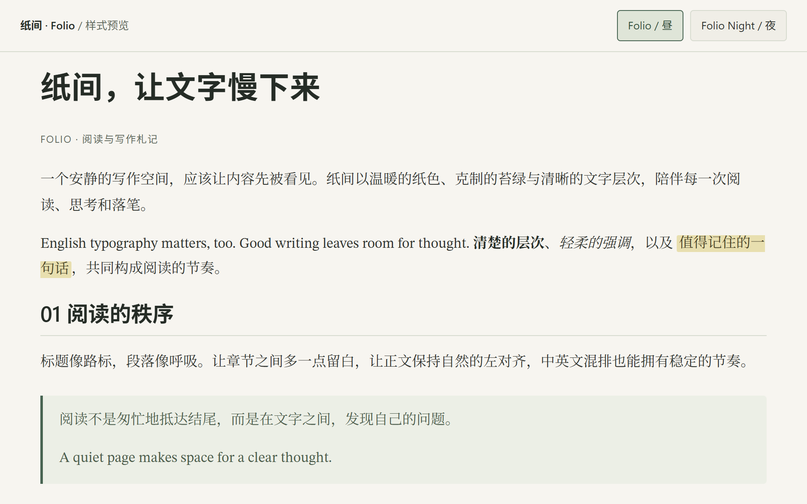
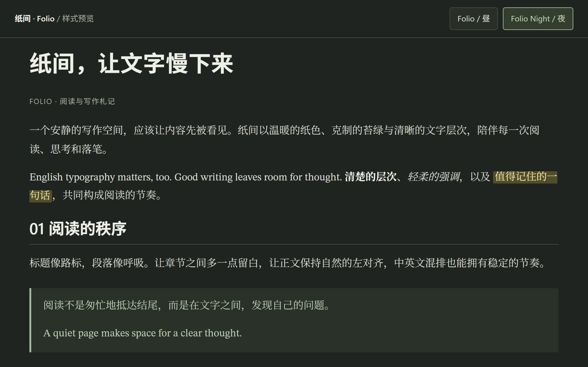
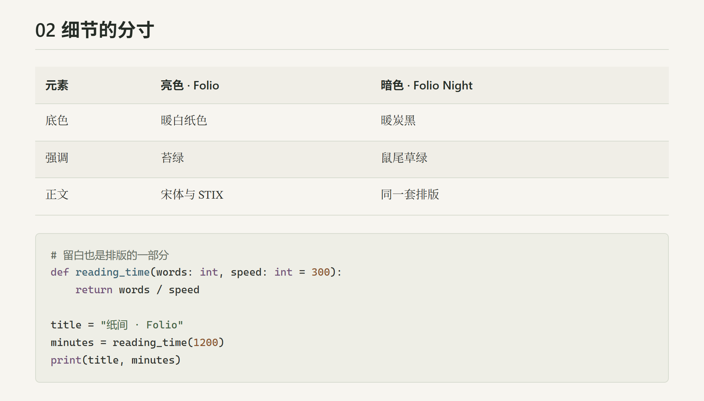

# 纸间 · Folio

现代书刊风的 Typora 主题，以温暖的配色、宋体正文与舒展的行距，营造安静的阅读和写作空间。

[English](README.md) · **简体中文**

## 主题预览

### Folio · 纸间·昼

暖白纸色，苔绿点缀。



### Folio Night · 纸间·夜

暖炭底色，鼠尾草绿点缀。



以上图片由仓库内的[浏览器预览页](folio/preview.html)渲染，实际 Typora 控件与渲染效果可能有所不同。在本地打开预览页即可切换两套配色。

## 特点

- 昼夜两套配色，共用同一套排版与布局。
- 随主题附带 STIX Two Text 英文字体，中文正文回退到本地宋体。
- 黑体标题、17px 正文与 1.8 倍行高。
- 正文占编辑区宽度的 90%，窄窗口自动适配。
- 表格、引用、代码、任务列表和脚注采用协调的样式。
- 打印与 PDF 导出使用白底深色文字。

### 表格与代码

表头默认与所在列的正文左对齐，同时保留 Markdown 显式指定的对齐方式。代码块使用主题配套的语法配色。



## 安装与使用

1. 点击仓库的 **Code → Download ZIP** 下载项目并解压。
2. 在 Typora 的「**偏好设置 → 外观 → 打开主题文件夹**」中打开主题目录。
3. 将 `folio.css`、`folio-night.css` 和整个 `folio` 文件夹复制进去，保持相对路径不变。
4. 重启 Typora，在「**主题**」菜单中选择 **Folio** 或 **Folio Night**。

主题目录应包含以下文件：

```text
themes/
├── folio.css
├── folio-night.css
└── folio/
    ├── folio-base.css
    ├── STIX2Text-Regular.woff
    ├── STIX2Text-Italic.woff
    ├── STIX2Text-Bold.woff
    ├── STIX2Text-BoldItalic.woff
    └── STIX_2.0.0_license.pdf
```

`docs` 文件夹和根目录的 README 文件仅用于仓库文档，无需复制到主题目录。

## 字体与微调

主题已附带 STIX Two Text。中文正文优先使用思源宋体 / Noto Serif CJK SC / Noto Serif SC，随后回退到 Songti SC 或宋体；标题使用可用的系统黑体。代码优先使用本机 Cascadia Code、JetBrains Mono 或 Consolas。字体均从本地加载。

修改 `folio.css` 或 `folio-night.css` 可调整对应配色；公共排版位于 `folio/folio-base.css`：

```css
:root {
    --folio-body-size: 17px;
    --folio-line-height: 1.8;
    --folio-reading-width: 90%;
}
```

修改后，将相关文件复制到 Typora 主题目录，再重新选择主题。更多细节见[主题说明（英文）](folio/README.md)。

## 字体许可

随主题附带的 STIX 字体保留其[原始许可文件](folio/STIX_2.0.0_license.pdf)。
